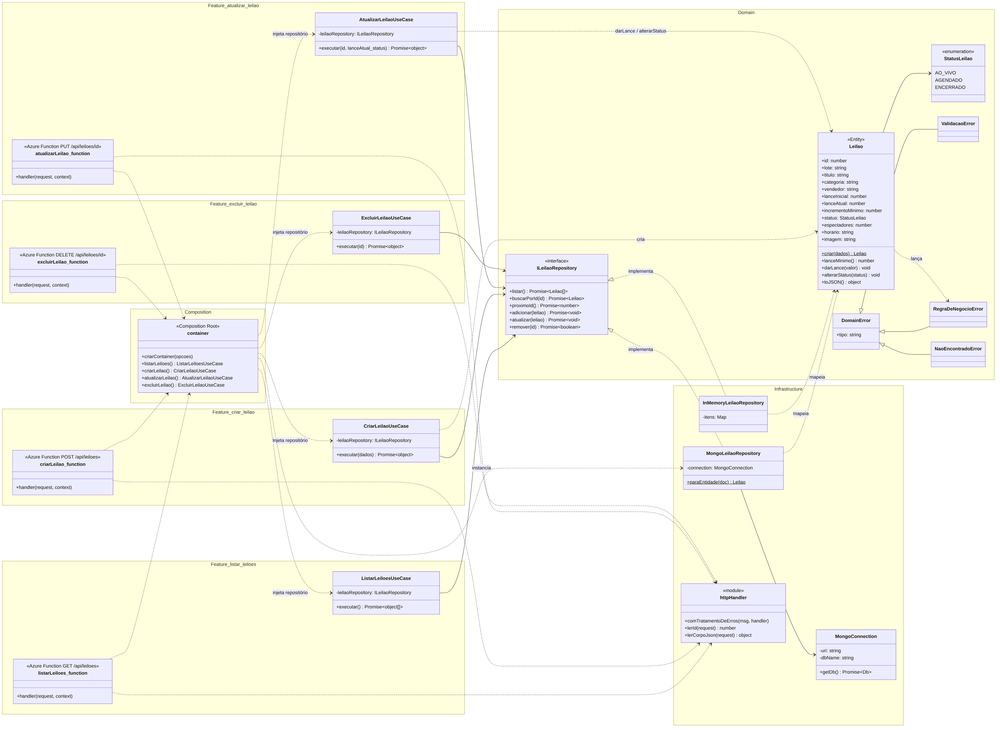
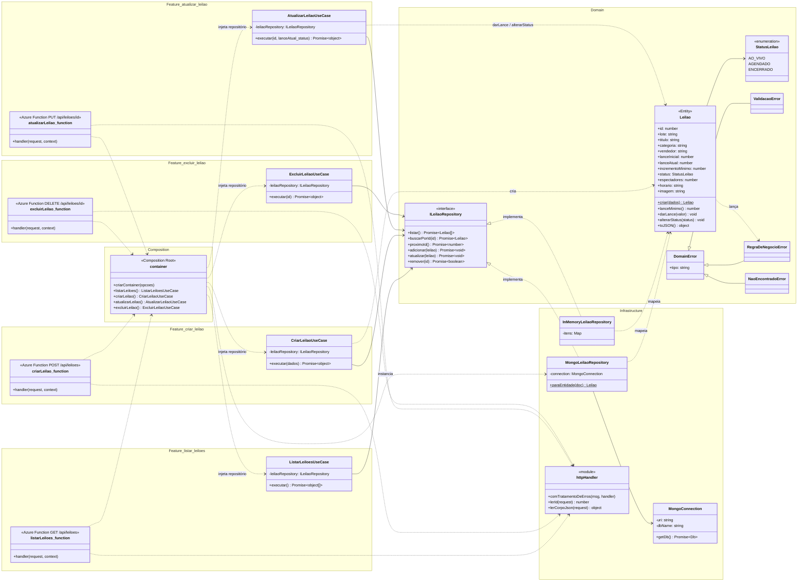
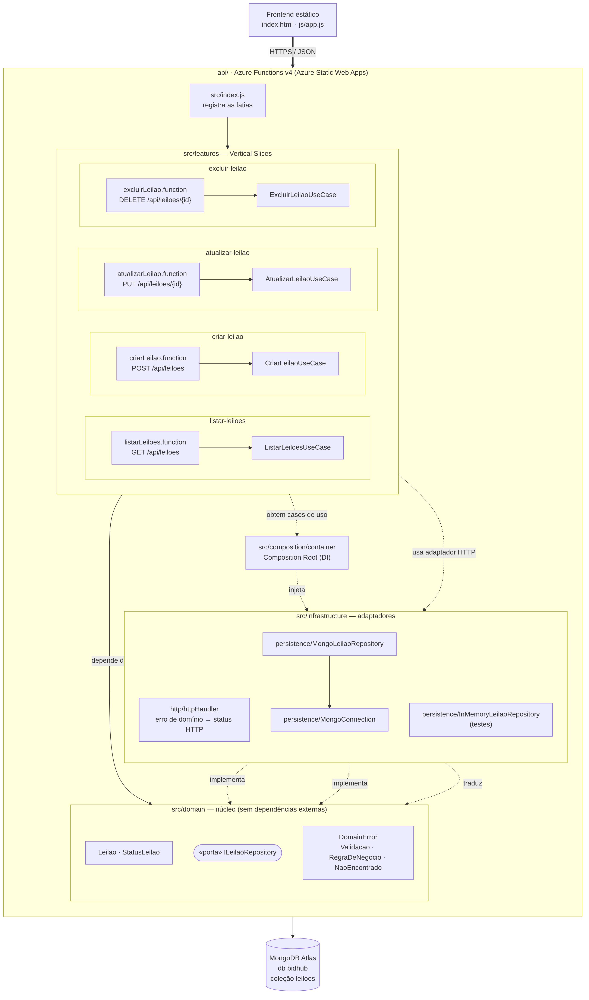
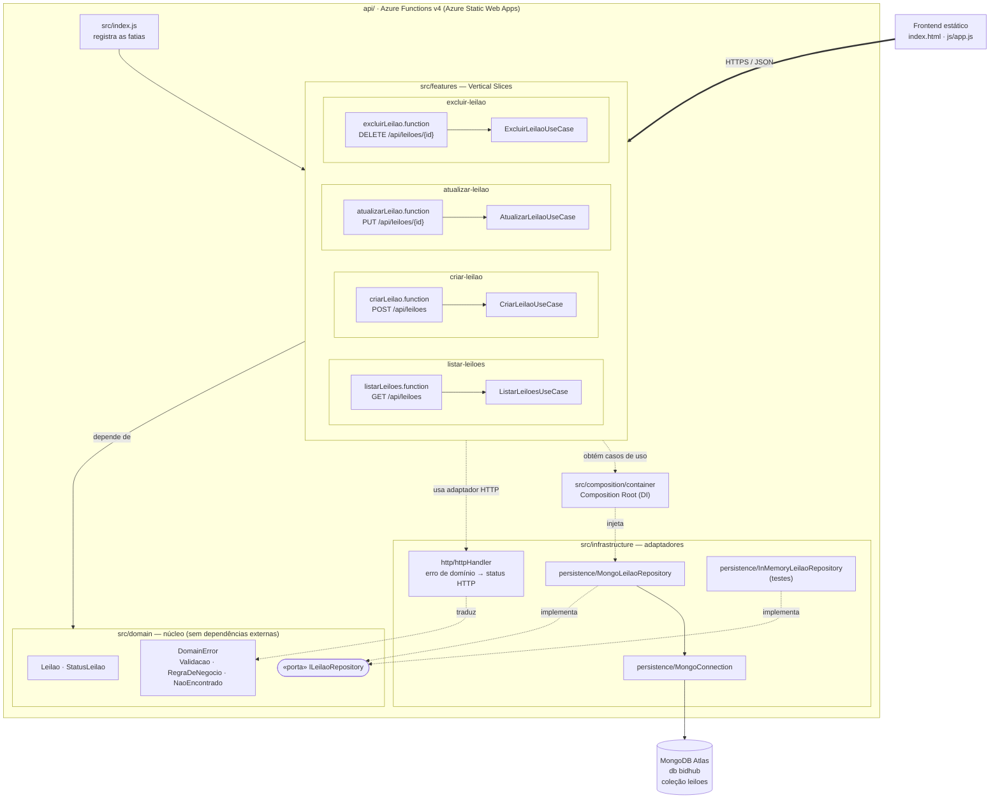

# Backend do BidHub — Vertical Slice + Clean Architecture

Nessa branch a gente reorganizou a pasta `api/`. As rotas continuam as mesmas
(`GET/POST /api/leiloes`, `PUT/DELETE /api/leiloes/{id}`), então o front não mudou nada.

## Como ficou

```
api/src/
├── index.js                 registra as rotas
├── features/                uma pasta por funcionalidade
│   ├── listar-leiloes/
│   ├── criar-leilao/
│   ├── atualizar-leilao/
│   └── excluir-leilao/
├── domain/                  Leilao, StatusLeilao, ILeilaoRepository e os erros
├── infrastructure/          Mongo, repositório em memória e o tratamento de erros http
└── composition/container.js monta os casos de uso com o repositório
```

Antes cada function fazia tudo: validava, calculava o lance mínimo e falava direto com o Mongo.
Agora cada pasta de `features` tem a rota e o caso de uso dela, as regras ficaram na classe
`Leilao` e o acesso ao banco ficou no `MongoLeilaoRepository`.

**Vertical Slice:** pra mexer em "criar leilão" a gente só abre `features/criar-leilao`.
Funcionalidade nova = pasta nova.

**Clean Architecture:** o `domain` não importa nada de Mongo nem de Azure. Os casos de uso
recebem um repositório e não sabem qual banco está por trás.

**SOLID:**
- **S** — cada classe faz uma coisa (conexão, repositório, caso de uso, tratamento http).
- **O** — pra criar um erro novo é só dar um `tipo` pra ele e colocar o status na tabela do `httpHandler`.
- **L** — o repositório em memória substitui o do Mongo nos testes sem mudar nada nos casos de uso.
- **I** — os casos de uso só recebem o repositório, não recebem `request` nem conexão.
- **D** — os casos de uso dependem do `ILeilaoRepository`; quem escolhe o Mongo é o `container.js`.

Mudanças pequenas de comportamento: a resposta não manda mais o `_id` do Mongo e JSON inválido
volta 400 (antes dava 500).

Testes: `cd api && npm test` (13 testes).

## Diagrama de classes





## Diagrama de componentes




